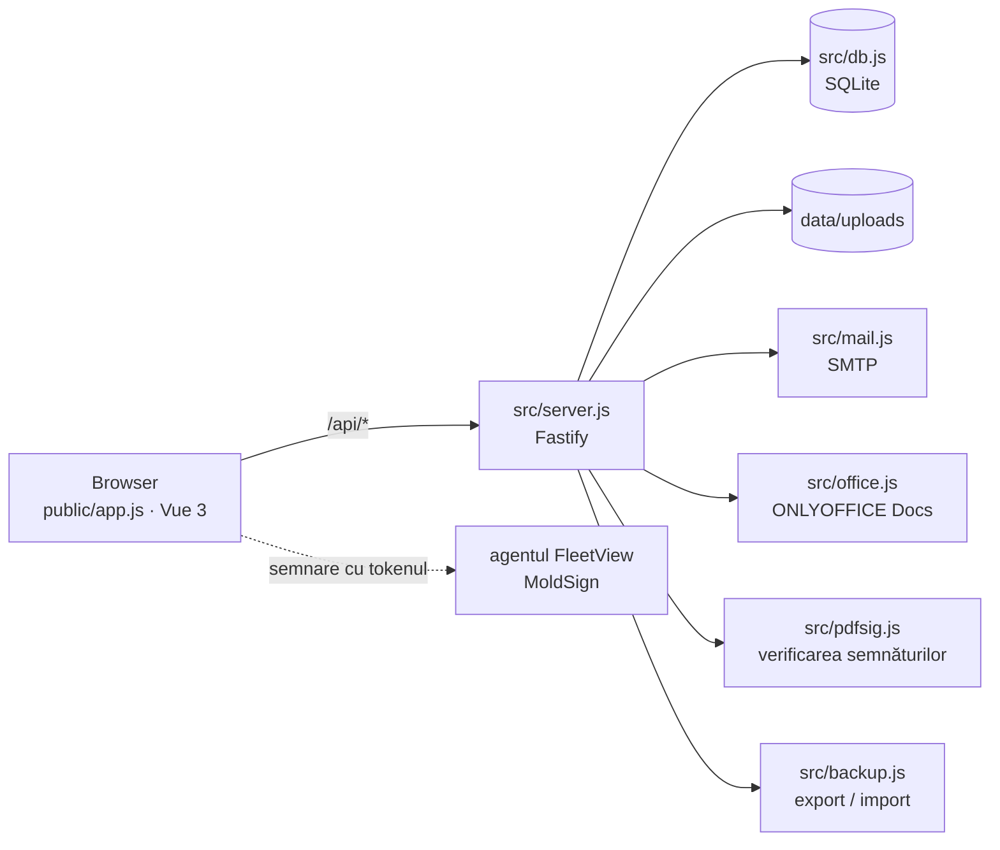

# e-Management ANSC: arhitectura

Cum este construită aplicația și unde se află fiecare parte. Ce face aplicația pentru utilizatori este descris în
[README](../README.md).

## Pe scurt

Un singur proces Node.js (≥ 22.13) cu [Fastify](https://fastify.dev): API-ul JSON, fișierele interfeței și Vue 3
servit local (`/vendor/vue.js`, din `node_modules`). Fără CDN, fără pas de build, fără telemetrie. Toate datele stau
în `data/` (sau `DATA_DIR`): baza SQLite (modulul integrat `node:sqlite`) și fișierele încărcate.

## Fișiere

| Fișier | Rol |
|---|---|
| `src/server.js` | Aplicația Fastify: autentificare și sesiuni, roluri, toate rutele `/api/*`, încărcări, lanțul de semnare, antetele de securitate și CSP |
| `src/db.js` | Schema, migrările și folderul fișierelor încărcate |
| `src/backup.js` | Exportul și importul complet `.anscbackup` |
| `src/mail.js` | Notificările prin e-mail (setările SMTP stau în baza de date) |
| `src/office.js` | Editarea în pagină prin ONLYOFFICE Docs |
| `src/pdfsig.js` | Verificarea semnăturilor PDF (PAdES / CMS), pe server și fără rețea |
| `src/ancore-md.pem` | Certificatele publice ale autorităților de certificare din Republica Moldova, pentru `pdfsig.js` |
| `public/` | Interfața: `index.html`, `app.js`, `style.css`, iconițele |
| `scripts/make-icons.js` | Generează iconițele |

## Conturi, roluri și acces

- **Roluri:** `admin` (tot), `editor` (adaugă documente și le modifică pe ale sale), `user` (vede și semnează).
- **Sesiuni:** cookie-ul `sid`, cu tokenurile păstrate în baza de date doar ca hash. Ieșirea, schimbarea parolei
  sau dezactivarea contului închid sesiunea imediat. La prima pornire se creează `admin` cu o parolă aleatorie
  (în jurnal și în `data/parola-initiala-admin.txt`), care trebuie schimbată la prima autentificare.
- **Cine vede un document** (`accessClause`): administratorii pe toate; ceilalți pe cele vizibile tuturor, pe cele
  create de ei, pe cele la care sunt adăugați ca persoane sau semnatari și pe cele adresate subdiviziunii lor sau
  uneia de deasupra ei. **Toate** citirile de documente și fișiere trec prin această regulă.
- **Modificare și ștergere:** editorul își modifică doar documentele proprii; un document semnat deja de cineva
  poate fi șters numai de un administrator.
- Fiecare rută `/api/*` are un `preHandler` (`requireUser`, `requireEditor` sau `requireAdmin`), iar schimbările
  importante ajung în jurnalul de audit.

## Fișiere și previzualizare

Fișierele încărcate primesc un nume de stocare generat. Doar PDF, PNG și JPEG se deschid în browser
(`INLINE_TYPES`); orice alt tip se descarcă (`application/octet-stream`), cu `nosniff`, ca un fișier încărcat să nu
poată rula cod în pagină. Versiunile anterioare ale unui fișier editat se păstrează (`file_versions`).

## Semnarea

1. Autorul alege semnatarii, în ordine (lanțul de semnare).
2. Fiecare semnatar, la rândul său, semnează cu tokenul personal prin **MoldSign**, prin puntea agentului
   **FleetView** de pe calculatorul său (vezi [fleet-manager](https://github.com/Akulav/fleet-manager)); aplicația
   emite un token de semnare de scurtă durată (`/api/sign/token`) pe care agentul îl validează.
3. `pdfsig.js` verifică pe server integritatea, semnătura criptografică, lanțul certificatului până la o autoritate
   de încredere și marca temporală. Revocarea (OCSP / CRL) nu se verifică: ar cere acces la internet.

## Editarea în pagină (opțional)

Cu un server ONLYOFFICE Docs în rețeaua internă, `office.js` construiește configurația semnată (JWT) pentru editor,
îi dă serverului de documente un link temporar spre fișier și primește înapoi versiunea salvată. Cine deschide
primul documentul îl poate edita; ceilalți îl văd doar pentru citire până când blocarea se eliberează.

## Copii de rezervă

`.anscbackup` este o arhivă Brotli cu baza de date și toate fișierele; fiecare intrare are sumă SHA-256, iar un
marcaj final dovedește că arhiva este întreagă. Importul verifică totul într-un folder temporar și abia apoi
înlocuiește datele, într-o singură tranzacție. Un import întrerupt își curăță folderul temporar la următoarea
pornire.

## Verificări

Nu există încă teste automate. CI (`.github/workflows/ci.yml`) rulează `npm ci` și verifică sintaxa fișierelor.
Schimbările se verifică pornind serverul cu un `DATA_DIR` temporar și alt `PORT`, niciodată pe folderul `data/` real.
